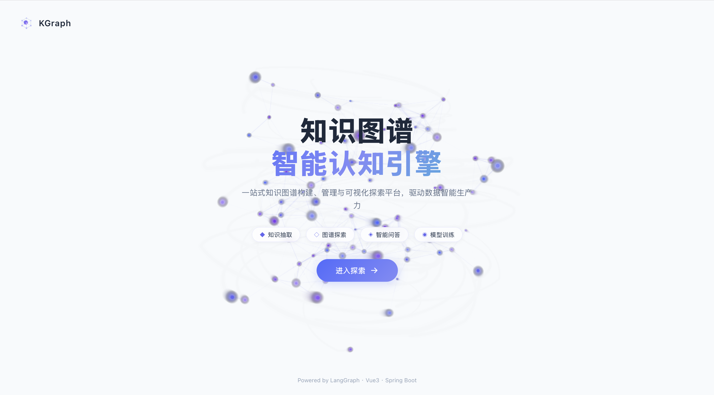
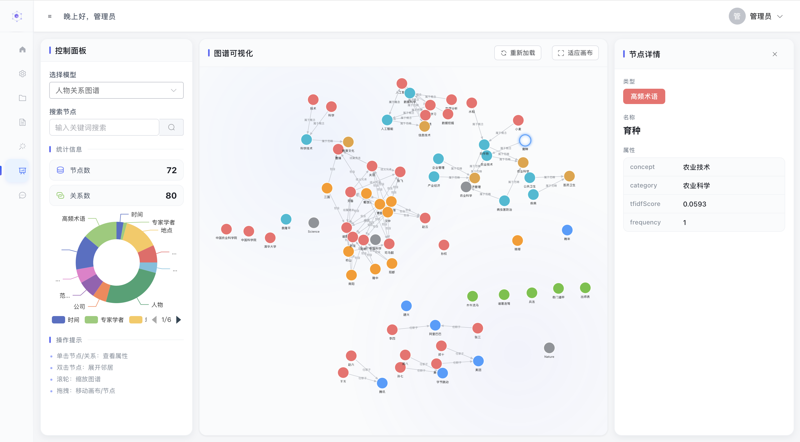

<p align="center">
  
</p>

<h1 align="center">KGraph 知识图谱管理系统</h1>

> 基于 Vue 3 + Spring Boot + FastAPI 的知识图谱构建、管理、训练与问答一体化平台。

<p align="center">
  <a href="LICENSE"></a>
</p>

KGraph 覆盖从语料接入、知识抽取、图谱构建、可视化探索到智能问答的完整链路，支持结构化、KOS、深度学习、LLM 四种抽取方式，集成 Neo4j 图数据库与 AntV G6 可视化。

## 系统截图

### 首页 Dashboard


### 图谱探索
基于 AntV G6 的交互式可视化，三栏布局，节点详情挤压式展开。


### 语料管理与文本分块
支持文本输入与文档上传（MinerU 解析），四种切分策略（定长滑窗、句子感知、递归分割、结构优先），实时预览。


### 知识抽取
四种抽取方式：结构化、KOS、深度学习、LLM。LLM 抽取采用两阶段流水线（节点抽取、关系抽取），支持双时态关系。


### 质量评估
内在指标（孤立实体率、平均度、证据覆盖率等）与 LLM-as-Judge 五维裁判（G-Eval 风格），支持 SSE 流式出分。


### 智能问答
LangGraph Agent + 9 个图谱工具，全链路 SSE 流式推送（思考过程、工具调用、回答逐字输出）。


### 模型管理与调用监控
多供应商模型配置（Ollama、OpenAI、Qwen、DeepSeek、GLM），按用户隔离；调用监控含统计卡片、趋势图与各模型消耗详情。


## 核心功能

- 项目与本体建模：多项目隔离，自定义实体类型、关系类型与属性，schema 多模型隔离
- 语料管理：文本输入、文档上传（MinerU 解析 PDF/Word）、四种文本切分策略，保留原文偏移可溯源
- 知识抽取：结构化（Excel/CSV 映射）、KOS（词表 + TF-IDF + 三层结构）、深度学习（CRF + 22 种实体）、LLM（两阶段流水线 + 双时态）
- 图谱探索：G6 交互式可视化，拖拽、缩放、邻居展开、属性详情
- 模型训练：训练任务管理、曲线监控、效果评估
- 数据标注：BIO 标签体系
- 智能问答：LangGraph Agent 编排，9 个图谱工具，SSE 全链路流式，会话持久化，模型动态切换
- 质量评估：内在指标 + LLM-as-Judge，SSE 流式出分
- MCP Server：知识抽取与评估能力封装为 MCP Tool，支持 stdio、SSE、streamable-http 三种传输层，供 Trae、Claude Desktop 等客户端调用

## 技术栈

| 层级 | 技术 |
|------|------|
| 前端 | Vue 3、Element Plus、Vite、TypeScript、AntV G6、ECharts、Pinia、Axios、marked |
| Java 主服务 | Spring Boot 3、MyBatis-Plus、MySQL 8、Neo4j 5、MinIO、Spring WebFlux（SSE）、Knife4j |
| Python 微服务 | FastAPI、OpenAI SDK、Neo4j Driver、LangChain、LangGraph、langchain-openai、MCP SDK |
| 外部服务 | MinerU（PDF/Word 解析） |

## 快速开始

### Docker 部署（推荐）

一键启动应用层（frontend、java、pybackend）；MySQL、Neo4j、Redis、MinIO 由外部提供。完整说明见 [docs/Docker部署指南.md](docs/Docker部署指南.md)。

前置条件：Docker 20.10+、Compose v2、已就绪的 MySQL/Neo4j/Redis/MinIO。

```bash
# 1. 配置容器专用地址（localhost 改为 host.docker.internal 或外部 IP）
vim docker/config/config.json
vim docker/config/application-local.yml

# 2. 初始化数据库（外部 MySQL 与 Neo4j）
mysql -h <host> -uroot -p < sql/kgraph.sql   # 按序导入 sql/*.sql
cypher-shell -a bolt://<neo4j-host>:7687 -u neo4j -p <pwd> -f sql/graph.sql

# 3. 构建并启动
docker compose up -d

# 4. 验证
curl http://localhost:8888/api/doc.html   # Java API 文档
curl http://localhost:8001/docs           # Python API 文档
curl http://localhost/                    # 前端登录页
```

### 本地开发

环境要求：JDK 17+、Node 18+、Python 3.10+、MySQL 8、Neo4j 5、Redis 7、MinIO、MinerU。

```bash
# 数据库初始化（见上方 SQL 导入）

# Java 主服务
cp src/main/resources/application-local.example.yml src/main/resources/application-local.yml
./mvnw spring-boot:run                    # http://localhost:8888/api

# Python 微服务
cd pybackend
cp config.example.json config.json
pip install -r requirements.txt
python main.py                            # http://localhost:8001

# 前端
cd frontend
npm install
npm run dev                               # http://localhost:5173
```

### MCP Server（可选）

独立进程，运行期仅依赖 LLM API，供 LLM 客户端调用知识抽取与评估工具。

```bash
cd pybackend
python mcp_server.py --transport stdio                       # 本地 Trae/Claude 接入
python mcp_server.py --transport streamable-http --port 8003 # Docker/远程部署
```

| Tool | 说明 |
|------|------|
| `kg_extract_full` | 两阶段 LLM 抽取与质量管道，输出实体、关系、时间锚点 |
| `kg_evaluate` | 内在指标与 G-Eval 五维裁判，对抽取结果打分 |

## 项目结构

```
KGraph/
├── frontend/                 # Vue 3 前端（Vite + TypeScript + G6）
├── src/main/java/.../seedboot/  # Spring Boot 主服务
├── pybackend/                # FastAPI 微服务（抽取、评估、Agent）
│   ├── api/                  # 路由
│   ├── core/                 # 核心算法（agent_tools、graph_writer、evaluation_core 等）
│   ├── splitter/             # 文本切分策略
│   ├── main.py               # FastAPI 入口
│   └── mcp_server.py         # MCP Server
├── sql/                      # MySQL 表结构与 Neo4j 约束
├── docker/                   # 容器编排与配置
│   └── config/               # config.json、application-local.yml
├── docker-compose.yml
├── Dockerfile                # Java
├── frontend/Dockerfile       # 前端（多阶段：node 构建 + nginx 运行）
├── pybackend/Dockerfile      # Python
└── docs/                     # 设计与部署文档
```

## 配置说明

包含敏感信息的配置文件已被 .gitignore 排除：

| 文件 | 用途 |
|------|------|
| `src/main/resources/application-local.yml` | Java 本地开发配置 |
| `pybackend/config.json` | Python 本地开发配置 |
| `docker/config/config.json` | Python 容器配置（外部地址） |
| `docker/config/application-local.yml` | Java 容器配置（外部地址） |

本地开发用前两份（localhost），Docker 部署用后两份（host.docker.internal 或外部 IP），互不干扰。

## License

MIT
